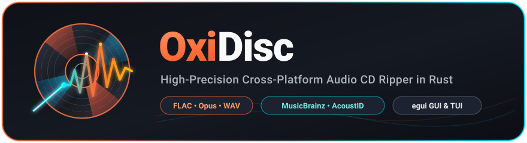
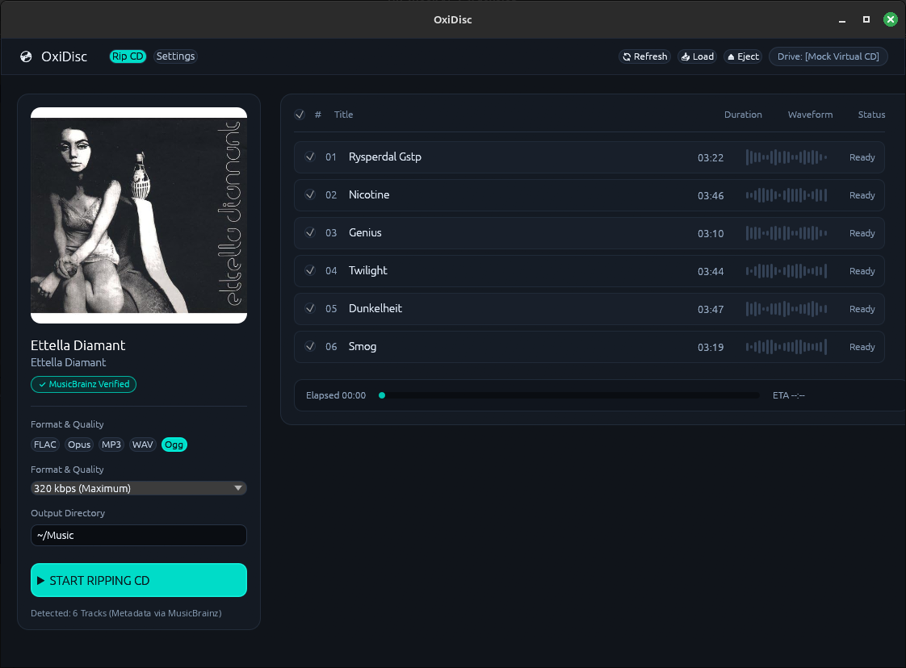
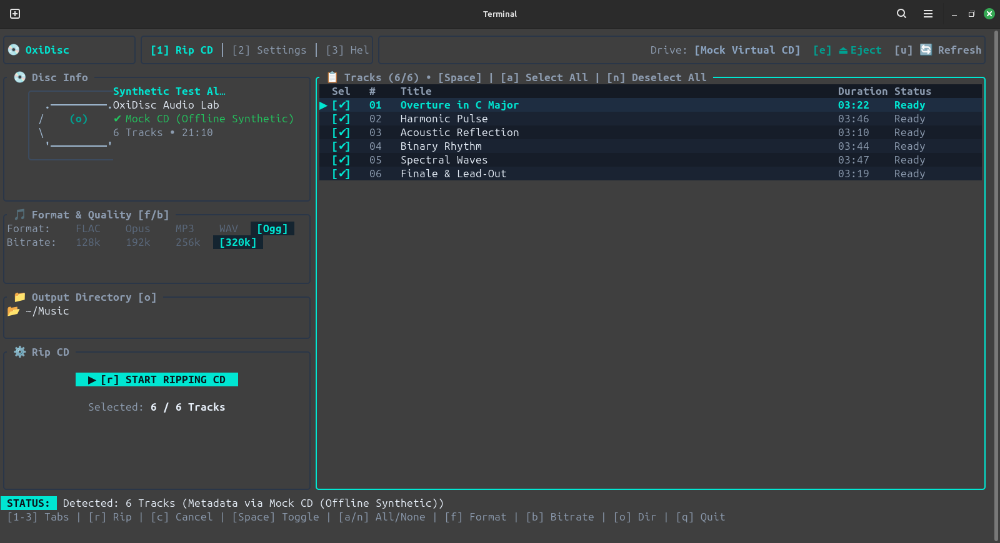

# 💿 OxiDisc



[](LICENSE)
[](https://www.rust-lang.org/)
[]()

**OxiDisc** is a modern, fast, cross-platform audio CD ripper written in Rust. It detects inserted optical discs, queries metadata across multiple providers (with acoustic audio fingerprinting fallback), fetches high-resolution album artwork, and extracts tracks to FLAC, MP3, WAV, Ogg Vorbis, or Opus. OxiDisc offers both a sleek modern GUI (egui) and a full terminal interface (Ratatui TUI).

---

## Features

- 💿 **Cross-Platform CDDA Extraction & Tray Control**
  - **Windows**: Pure-Rust native CDDA ripper using Win32 `DeviceIoControl` / `MCI` and raw sector extraction. Native drive tray open/eject (`⏏`) and close/load (`📥`) hardware controls. Runs self-contained without requiring external tools like `cdparanoia`.
  - **Linux**: High-fidelity ripping powered by `cdparanoia` with direct Linux kernel `ioctl` fallback and native `eject` / `eject -t` tray control.
- 🔍 **Multi-Provider Metadata Cascade**
  - **MusicBrainz**: DiscID matching and rich album metadata, with high-resolution artwork from the [Cover Art Archive](https://coverartarchive.org/).
  - **GnuDB (FreeDB)**: Fast community CDDB catalog querying.
  - **AcoustID (Chromaprint)**: Raw acoustic audio fingerprinting computed directly from track audio samples. Recognizes custom CD-Rs, uncatalogued pressings, and discs without DiscIDs.
  - **Auto-Cascade Mode**: Automatically queries MusicBrainz &rarr; GnuDB &rarr; AcoustID in sequence until metadata is found.
- 🎨 **Dual Frontends (GUI & TUI)**
  - **`egui-ui` (Modern GUI)**: Cross-platform interface for Windows and Linux. Responsive layout, real-time per-track and overall progress bars, dark theme, and embedded album art preview.
  - **`tui` (Terminal UI / Ratatui)**: Full terminal-based interface mirroring the modern GUI design. Perfect for headless servers, SSH sessions, and terminal enthusiasts.
- 🎵 **Extensive Audio Format Support**
  - **FLAC**: Lossless audio compression (100% Pure-Rust built-in via `flacenc`, zero external tools needed).
  - **WAV**: Uncompressed 16-bit 44.1 kHz stereo PCM (100% Pure-Rust built-in).
  - **Opus**: State-of-the-art lossy compression via `opusenc` (`opus-tools`) or `ffmpeg` fallback.
  - **MP3**: High-compatibility encoding via `lame` (128–320 kbps) or `ffmpeg` fallback.
  - **Ogg Vorbis**: High-quality Vorbis encoding via `oggenc` (`vorbis-tools`) or `ffmpeg` fallback.
- 🧪 **Hardware-Free Mock Mode & Testing**
  - Full virtual CD emulation built-in (`--mock-cd`) for testing metadata, tracklist display, and ripping conversions without needing a physical optical drive.
  - CUE/BIN disc image generation for virtual drive software.
- 🖼️ **Album Art Management**
  - Live cover preview in the UI.
  - Size preference configuration: `auto`, `small`, `large`, or `original`.
  - Configurable download behavior (`preview-only` or `save-with-rip` as `cover.jpg` / `folder.jpg`).
- 🌐 **Multi-Language Support (i18n)**
  - Full EFIGS (English, French, Italian, German, Spanish) plus Portuguese, Japanese, Russian, Polish, and Chinese (`auto`, `en`, `de`, `fr`, `it`, `es`, `pt`, `ja`, `ru`, `pl`, `zh`).
  - Automatic system language detection (`LANG` / `LC_MESSAGES` / `LC_ALL`) and live in-app language switcher across both GUI and TUI frontends.


---

## Screenshots

| Modern GUI (`egui`) | Terminal UI (`ratatui`) |
| :---: | :---: |
|  |  |

---

## Installation & Prerequisites

### Linux

Install the required runtime utilities and audio encoders:

#### Debian / Ubuntu / Mint
```bash
sudo apt-get install cdparanoia cd-discid eject flac lame vorbis-tools opus-tools libdiscid0 fonts-noto-cjk libgstreamer1.0-0 libgstreamer-plugins-base1.0-0 gstreamer1.0-plugins-base gstreamer1.0-plugins-good gstreamer1.0-plugins-ugly
```

#### Arch Linux / Manjaro
```bash
sudo pacman -S cdparanoia cd-discid eject flac lame vorbis-tools opus-tools libdiscid noto-fonts-cjk gstreamer gst-plugins-base gst-plugins-good gst-plugins-ugly
```

#### Fedora / RHEL
```bash
sudo dnf install cdparanoia cd-discid util-linux flac lame vorbis-tools opus-tools libdiscid google-noto-sans-cjk-fonts gstreamer1 gstreamer1-plugins-base gstreamer1-plugins-good gstreamer1-plugins-ugly-free
```

> [!TIP]
> On Linux, your user account must have permissions to read optical drives. Ensure your user is in the `cdrom` group:
> ```bash
> sudo usermod -aG cdrom "$USER"
> ```
> *(Log out and log back in for changes to take effect.)*

Alternatively, run the automated dependency setup script:
```bash
scripts/install-deps.sh
```

### Windows

On Windows, OxiDisc uses native Win32 APIs for CDDA reading, DiscID computation, and drive tray controls (Eject & Load), with no external CD drivers needed:

- **FLAC & WAV (Zero Dependencies)**: Pure-Rust built-in encoders (`flacenc` and PCM WAV). Work immediately out of the box without any external tools.
- **Opus, MP3, Ogg Vorbis**: OxiDisc supports standalone CLI encoders as well as **FFmpeg** as a universal fallback. If not already installed, install via Windows Package Manager (`winget`):

```powershell
# Universal solution (supports Opus, MP3, Ogg Vorbis):
winget install Gyan.FFmpeg

# Or individual standalone tools:
winget install Xiph.Org.Opus-Tools
winget install RareWares.Lame
```

> [!TIP]
> If an encoder tool is missing when ripping to Opus/MP3/Ogg, OxiDisc displays an interactive dialog with one-click options to rip directly to lossless **FLAC (built-in)** or **WAV**.

---

## Building from Source

OxiDisc requires a standard Rust toolchain (Edition 2024, Rust 1.85+).

### Linux / Cross-Platform
```bash
cargo build --release --locked
```

---

## Invocations & Usage

### 1. Running the Compiled Binary

```powershell
# Windows (PowerShell / CMD)
.\target\release\oxidisc.exe

# Linux (Terminal)
./target/release/oxidisc
```

### 2. Running via Cargo

```bash
# Launch modern egui GUI
cargo run

# Launch Terminal UI (Ratatui)
cargo run -- --tui

# Launch in hardware-free test mode
cargo run -- --mock-cd

# Explicitly select UI backend
cargo run -- --ui egui
cargo run -- --ui tui
```

### 3. CLI Command-Line Options

| Option | Alias | Description | Example |
| :--- | :--- | :--- | :--- |
| `--tui` | | Launch Terminal UI (Ratatui) | `oxidisc --tui` |
| `--ui <egui\|tui>` | `--feature` | Select active UI frontend and save preference | `oxidisc --ui egui` |
| `--mock-cd` | `--mock`, `--test` | Run with virtual test CD data (no CD drive needed) | `oxidisc --mock-cd` |
| `--generate-test-disc [dir]` | | Generate CUE/BIN audio CD test image files on disk | `oxidisc --generate-test-disc test_data` |
| `--device <path>` | `-d <path>` | Specify or override the CD drive path | `oxidisc --device D:` |
| `--help` | `-h` | Display usage instructions and options | `oxidisc --help` |

### 4. Hardware-Free Testing & Mock Mode

You can test metadata retrieval, track previewing, and audio conversion to all formats **without needing physical optical hardware**:

```bash
# Launch directly in virtual Mock CD mode
oxidisc --mock-cd

# Or set the environment variable
CD_DEVICE=mock oxidisc

# Or via Cargo
cargo run -- --mock-cd
```

In Mock Mode:
- A realistic 6-track audio CD Table of Contents (TOC) is simulated, matching the official MusicBrainz test vector.
- Queries live metadata from MusicBrainz, GnuDB, or AcoustID, with automatic fallback to built-in offline test metadata if offline.
- Synthesizes 16-bit 44.1 kHz stereo PCM harmonic tones on-the-fly when ripping tracks.
- Exercises the full encoding pipeline to FLAC, MP3, WAV, Ogg Vorbis, and Opus.

#### Generating Standalone Test Disc Images (CUE/BIN)

To create image files that can be mounted in virtual drive emulators (e.g. WinCDEmu, Virtual CloneDrive, `cdemu`):

```bash
# Built-in generator
oxidisc --generate-test-disc test_data

# Or via PowerShell script (Windows)
powershell -ExecutionPolicy Bypass -File scripts/create-test-disc.ps1

# Or via Python (Linux / macOS / Windows)
python scripts/create-test-disc.py
```

### 5. Running Automated Tests

```powershell
# Run all unit and integration tests (37 tests)
cargo test --features "egui-ui"

# Run tests with output printed
cargo test --features "egui-ui" -- --nocapture
```

---

## Environment Variables

| Variable | Description | Default |
| :--- | :--- | :--- |
| `CD_DEVICE` | Override the optical drive path (`/dev/sr0`, `D:`, `mock`) | Auto-detected (`/dev/sr0` on Linux, first CD drive on Windows) |
| `OXIDISC_MOCK_CD` | Set to `1` to force mock CD mode without CLI flags | `0` |
| `OXIDISC_CONFIG` | Path to custom `config.toml` file | OS standard config directory |

Example:
```bash
CD_DEVICE=/dev/sr1 oxidisc
```

---

## Configuration

Configuration is stored in `config.toml`. OxiDisc looks for configuration in the following order:
1. Path specified by `OXIDISC_CONFIG`
2. Repository-local `config/config.toml` (if running from a repository checkout)
3. Standard user configuration path:
   - **Linux**: `~/.config/oxidisc/config.toml`
   - **Windows**: `%APPDATA%\oxidisc\config.toml`

### Example `config.toml`

```toml
encoder = "flac"
bitrate = "320"
quality = "8"
device = "/dev/sr0"
ui_backend = "egui"
metadata_source = "auto"
album_art_size_preference = "large"
album_art_download_behavior = "preview-only"
```

### Configuration Options

| Option | Values | Default | Description |
| :--- | :--- | :--- | :--- |
| `encoder` | `"flac"`, `"mp3"`, `"wav"`, `"ogg"`, `"opus"` | `"flac"` | Audio encoder / output format |
| `bitrate` | `"128"`, `"192"`, `"256"`, `"320"` | `"320"` | MP3 target bitrate (kbps) |
| `quality` | `"0"` to `"10"` | `"8"` | Ogg Vorbis quality level |
| `device` | string (e.g. `"/dev/sr0"`, `"D:"`, `"mock"`) | platform default | Optical drive device path |
| `ui_backend` | `"egui"`, `"tui"` | `"egui"` | Default UI frontend |
| `language` | `"auto"`, `"en"`, `"de"`, `"fr"`, `"it"`, `"es"`, `"pt"`, `"ja"`, `"ru"`, `"pl"`, `"zh"` | `"auto"` | UI localization (10 languages + system auto-detect) |
| `metadata_source` | `"auto"`, `"musicbrainz"`, `"gnudb"`, `"acoustid"` | `"auto"` | Metadata provider or automatic cascade |
| `album_art_size_preference` | `"auto"`, `"small"`, `"large"`, `"original"` | `"auto"` | Preferred album cover image resolution |
| `album_art_download_behavior`| `"preview-only"`, `"save-with-rip"` | `"preview-only"` | Whether to save cover art file alongside ripped tracks |
| `auto_create_output_dir` | `true`, `false` | `false` | Automatically create missing output folders without confirmation modal |

---

## Packaging

Linux packaging recipes and scripts are located in `packaging/`:
- **AppImage**: `packaging/appimage/build-appimage.sh`
- **Debian / Ubuntu (`.deb`)**: `packaging/debian/` & `cargo-deb` definition in `Cargo.toml`
- **Arch Linux (AUR)**: `packaging/aur/PKGBUILD`
- **Fedora / RHEL (RPM / COPR)**: `packaging/fedora/oxidisc.spec`
- **Flatpak**: `packaging/flatpak/`
- **Snap**: `packaging/snap/`

See [docs/PACKAGING.md](docs/PACKAGING.md) and [docs/Distribution Instructions.md](docs/Distribution%20Instructions.md) for detailed packaging and release workflows.

---

## License

OxiDisc is distributed under the **MIT License**. See [LICENSE](LICENSE) for details.

### Authors & Maintainers
- **Alexander Drichel**

### Acknowledgements
- Originally based on [CeeDee-Ripper](https://github.com/odioski/CeeDee-Ripper) by Omar Daniels.
