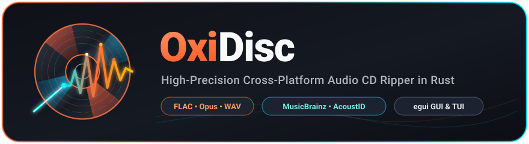

# Packaging Notes

These notes are for local validation and build preparation across all packaging formats. Do not push, publish, upload, or trigger remote packaging from this checkout unless explicitly requested.

---

## Local Build Matrix

OxiDisc supports both single-frontend and universal multi-frontend builds:

### 1. Cross-Platform GUI Build (`egui-ui`)
Builds the lightweight, pure-Rust GUI interface without GTK or GStreamer C-dependencies. Recommended for desktop environments:

```bash
cargo check --locked --no-default-features --features "egui-ui"
cargo build --release --locked --no-default-features --features "egui-ui"
```

### 2. Dual Frontend Binary (`egui-ui` + `tui`)
Compiles both `egui` and `Ratatui TUI` into a single binary. The active interface is selectable at runtime with `--ui` (`--ui egui` or `--ui tui`), or via the configuration file:

```bash
cargo check --locked --features "egui-ui tui"
cargo build --release --locked --features "egui-ui tui"
```

In universal builds:
- `oxidisc --ui egui` and `oxidisc --ui tui` select the interface for that launch and save the choice in `config.toml`.
- Without a selector, the app reads `ui_backend` from `~/.config/oxidisc/config.toml` (Linux) or `%APPDATA%\oxidisc\config.toml` (Windows), falling back to `egui`.

---

## Package Formats & Targets

### Debian / Ubuntu (`.deb`)

Package metadata is maintained in `Cargo.toml` under `[package.metadata.deb]` and in `packaging/debian/`:

```bash
# Build binary .deb with cargo-deb
cargo deb --no-strip
```

Installed paths:
- `/usr/bin/oxidisc`
- `/usr/share/applications/oxidisc.desktop`
- `/usr/share/icons/hicolor/256x256/apps/oxidisc.png`
- `/usr/share/metainfo/io.github.dral.oxidisc.metainfo.xml`

Runtime dependencies declared:
`cdparanoia`, `cd-discid`, `eject`, `flac`, `lame`, `vorbis-tools`, `opus-tools`, `libdiscid0`, `fonts-noto-cjk | fonts-droid-fallback`.

### AppImage

Build the standalone portable AppImage for x86_64 Linux:

```bash
packaging/appimage/build-appimage.sh
```

The resulting AppImage will be placed in `target/appimage/oxidisc-2.0.0-x86_64.AppImage`.

### Arch Linux (AUR)

Maintained in `packaging/aur/PKGBUILD`. Test building locally with:

```bash
cd packaging/aur
makepkg -si
```

### Fedora / RHEL (RPM & COPR)

Maintained in `packaging/fedora/oxidisc.spec`. Validate and build SRPM:

```bash
rpmbuild -bs packaging/fedora/oxidisc.spec
```

### Flatpak

Maintained in `packaging/flatpak/io.github.dral.oxidisc.yml` and `generated-sources.json`.
Build locally with `flatpak-builder`:

```bash
flatpak-builder --force-clean --repo=target/flatpak-repo target/flatpak-build packaging/flatpak/io.github.dral.oxidisc.yml
```

### Windows Binary Distribution

For Windows, build the release executable:

```powershell
cargo build --release --locked --no-default-features --features "egui-ui"
```

The standalone binary is generated at `target/release/oxidisc.exe`. It can be packaged into a zip archive with required encoder binaries or an installer (Inno Setup / WiX).

---

## Desktop & AppStream Metadata Validation

Run local compliance checks before releases:

```bash
desktop-file-validate resources/oxidisc.desktop
appstreamcli validate --pedantic resources/metainfo/io.github.dral.oxidisc.metainfo.xml
```

---

## Upstream Release Anchor

All distro recipes target the upstream Git release tag `v2.0.0`.
